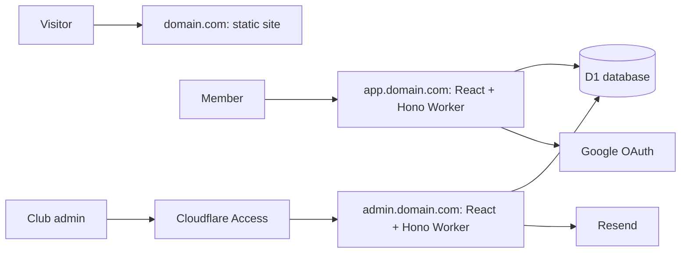
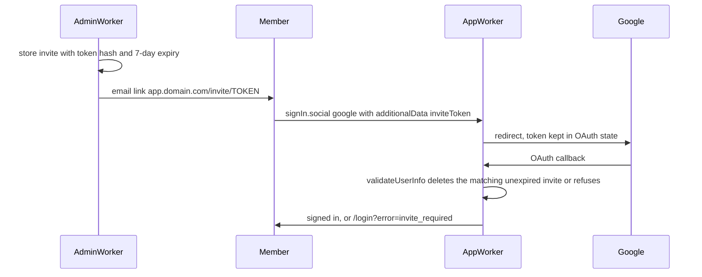

# Hampset CC Website Plan

## Hosting and stack decisions

Everything is hosted on Cloudflare. DDoS protection, TLS and CDN come free, and on the free plan going over a limit makes requests fail rather than adding to the bill. The only fixed cost is the domain at about £10 a year.

- **Three deployments, one domain:**
  - `domain.com`: the public site, served as static files by a Worker with no code (static asset requests are free and unlimited).
  - `app.domain.com`: the members app. A Worker serves the React build and a Hono API.
  - `admin.domain.com`: the admin app. Same shape as the members app, behind Cloudflare Access.
- **Public site:** React with [React Router](https://reactrouter.com) framework mode, pre-rendering every page to static HTML at build time. Pages show up properly in search results and in WhatsApp and Facebook link previews. Content lives in the route components; there is no CMS.
- **Members and admin apps:** React, Vite and TypeScript, with TanStack Query for data fetching. The [Cloudflare Vite plugin](https://developers.cloudflare.com/workers/vite-plugin/) runs each React app and its Worker on one dev server, and the build produces a single deployable Worker per app.
- **APIs:** [Hono](https://hono.dev) on Cloudflare Workers.
- **Database:** Cloudflare D1 (SQLite) through Drizzle ORM. The schema and migrations live in `packages/db`, and both Workers bind the same database.
- **Member auth:** [Better Auth](https://better-auth.com) in the members Worker, with sessions in D1. Google is the only sign-in method, so the app never sends login emails. New accounts need an invite.
- **Admin auth:** [Cloudflare Access](https://developers.cloudflare.com/cloudflare-one/policies/access/) (Zero Trust, free for up to 50 users). Admins are managed in the Cloudflare dashboard, not in the database, and the Worker verifies the Access login token on every request.
- **Email:** Resend's free tier (3,000 a month, 100 a day), used only for invite emails for now.
- **Theme:** dark blue and light silver, defined once as Tailwind tokens in `packages/shared/src/theme.css`.



### Repo layout

```
apps/site/        React Router, prerendered; static-assets Worker
apps/app/         src/ (React) + worker/ (Hono, Better Auth)
apps/admin/       src/ (React) + worker/ (Hono, Access check, Resend)
packages/db/      Drizzle schema, migrations, invite helpers
packages/shared/  theme.css, club.ts, UI components, API fetch helper
```

## Data model

- **Better Auth tables:** `user`, `session`, `account`, `verification`.
- **`invite`:** columns `id`, `email` (unique), `token_hash` (unique, SHA-256 of the link token), `expires_at`, `created_at`. Only pending invites are stored: claiming an invite deletes its row, and re-inviting an email replaces its row.

Removing a member deletes their `user` row, and the foreign keys cascade to their sessions and accounts.

## Invite flow



Existing members sign in without an invite, because no account is created.

## Bootstrap (done)

1. Monorepo structure with shared `db` and `shared` packages.
2. Public site with Home, About and Contact, using Hampset's details, plus a pre-rendered 404 page.
3. Members app: Google sign-in, invite page, login page with error messages, and a placeholder landing page.
4. Admin app: invite form, pending invites with revoke, members list with remove.
5. Tests with `@cloudflare/vitest-plugin` against a real local D1:
   - invite claiming (valid, unknown, expired, reused, replaced);
   - the sign-up gate;
   - `/api/me`;
   - the Access token check;
   - invite creation and validation;
   - CSRF rejection;
   - member removal.
6. CI that checks everything, refuses to deploy placeholder config, applies migrations and deploys all three Workers.

## Go live

Follow the "First-time Cloudflare setup" checklist in the README: domain, D1, Google OAuth, secrets, Resend, the Zero Trust Access application, GitHub secrets and WAF settings.

## Future features (considered, not planned in detail)

- **Coaching and bookings:** coach profiles, availability slots and member bookings in the members app, with confirmation emails. This needs roles inside the members app (for example a `user_role` table for coaches), managed from the admin app. Watch the Resend daily limit when adding reminder emails.
- **Fixtures and results:** pull from the Play-Cricket API on a Cron Trigger, and render on the static site at build time or in the members app.
- **Team selection and availability:** a `fixture_availability` table, reusing the booking pattern.
- **News:** a `news` route on the static site with posts as Markdown files, or a table edited from the admin app if non-technical editors need it.
- **Club shop and membership fees:** Stripe Checkout (hosted, no card data on our systems) and Stripe Subscriptions, with a webhook Worker writing `order` and `membership` rows.
- **Audit log:** record invites, revocations and removals with the admin's Access email, once more people share admin duties.

## Costs summary

- Domain: about £10 a year.
- Cloudflare Workers free tier (100k requests a day; static site requests are free and unlimited), D1 free tier (5GB), Zero Trust free plan (up to 50 admins), WAF managed rules: £0.
- Resend free tier: £0.
- If you outgrow the free tier: Workers paid plan at $5 a month.
