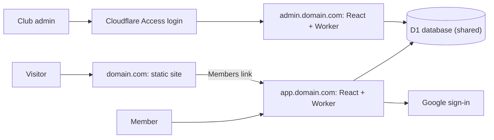

# Hampset Cricket Club website

The website, members area and admin tools for [Hampset Cricket Club](https://hampsetcc.play-cricket.com), Bath.
Everything runs on Cloudflare's free tier. The roadmap and design decisions are in [PLAN.md](PLAN.md).

| Address            | Folder       | What it is                                                                  | Who can use it                      |
| ------------------ | ------------ | --------------------------------------------------------------------------- | ----------------------------------- |
| `domain.com`       | `apps/site`  | Public website: Home, About, Contact. Pre-built to static HTML.             | Everyone                            |
| `app.domain.com`   | `apps/app`   | Members area: Google sign-in, admin approval. React app plus an API Worker. | Members an admin has approved       |
| `admin.domain.com` | `apps/admin` | Admin dashboard: approve and manage members. React app plus an API Worker.  | People allowed by Cloudflare Access |

Shared code lives in `packages/`:

- `packages/db`: the Drizzle database schema and migrations, used by both Workers.
- `packages/shared`: the colour theme, club details (name, address, email, ...), UI components and the API fetch helper.



## How sign-in works

- **Members** sign in with Google. Anyone can sign in, but new accounts can't see anything until an admin approves them.
- **Admins** never sign in to the members app. `admin.domain.com` sits behind [Cloudflare Access](https://developers.cloudflare.com/cloudflare-one/policies/access/), so Cloudflare checks who they are before a request reaches the site. You choose who's allowed in from the Cloudflare dashboard. The free plan covers up to 50 admins.

### Approving a member

1. The person opens `app.domain.com` and clicks **Continue with Google**. Google must have verified their email address. Their account is created with `approved_at` empty, and they see "Waiting for approval".
2. They appear under **Waiting for approval** on the admin dashboard. Approve by their Google email, not their name: anyone can give a Google account any name.
3. **Approve** sets `approved_at`; they get in the next time they load the app. **Reject** disables the account, so they can't just sign up again; it moves to **Disabled**.

Members are managed from the same dashboard:

- **Disable** sets `disabled_at`. They stay signed in but only see "Access removed", and **Enable** restores them with their data intact (a rejected sign-up goes back to waiting for approval).
- **Delete** (for disabled members) removes the user along with their sessions and linked Google account. With no row left, they can sign up again, so keep people disabled if you want them blocked.

Every approve, disable, enable and delete is recorded in the `audit_log` table with the admin's Access email, and the latest entries show under **Recent activity**.

## Local development

Requires Node 26 (LTS) and pnpm 10.

```bash
pnpm install
cp apps/app/.dev.vars.example apps/app/.dev.vars       # then fill in the values below
cp apps/admin/.dev.vars.example apps/admin/.dev.vars
pnpm db:migrate:local
pnpm dev
```

| App         | URL                     |
| ----------- | ----------------------- |
| Public site | <http://localhost:5173> |
| Members app | <http://localhost:5174> |
| Admin       | <http://localhost:5175> |

`pnpm dev` starts all three. The members app starts first, and the admin app waits for it, because both use the same local database in `.wrangler/state` and can't open it at exactly the same moment.

### Local settings

`apps/app/.dev.vars`:

- `BETTER_AUTH_SECRET`: any long random string, for example from `openssl rand -base64 32`.
- `GOOGLE_CLIENT_ID` and `GOOGLE_CLIENT_SECRET`: only needed to try real Google sign-in locally, because the dev server signs you in as a test account (see below). Create an OAuth client in the [Google Cloud console](https://console.cloud.google.com/apis/credentials). The application type is "Web application", and the authorised redirect URI is `http://localhost:5174/api/auth/callback/google`. While the consent screen is in "Testing", add your own Google account as a test user.

`apps/admin/.dev.vars`:

- `ACCESS_AUD` stays empty. With it empty, the dev server skips the Cloudflare Access check and records admin actions as `dev@localhost`. Production builds always enforce the check, because the skip is removed at build time.

### Trying the approval flow locally

The dev server signs you into the members app automatically as **Test Member** (`test.member@localhost`), so you don't need Google set up. The first time, the account is created as a new sign-up, just as if you'd signed in with Google.

1. Open <http://localhost:5174>. You'll see "Waiting for approval".
2. Open <http://localhost:5175> and click **Approve** next to `test.member@localhost`.
3. Reload the members app and you'll land on the home page. **Disable** on the dashboard switches it to "Access removed", and **Enable** brings it back.
4. To start over as a brand-new sign-up, disable then delete the account. The next visit to the members app creates it again.

Signing out sends you to the login page, which signs you straight back in. Auto sign-in needs `APP_URL=http://localhost:5174` in `apps/app/.dev.vars`. The sign-in route lives in `apps/app/worker/dev.ts`. Production builds leave it out because it sits behind `import.meta.env.DEV`, and `pnpm build` fails if it ever shows up in the bundle (`apps/app/scripts/check-build.sh`).

### Useful commands

| Command                 | What it does                                                 |
| ----------------------- | ------------------------------------------------------------ |
| `pnpm dev`              | Run all three apps                                           |
| `pnpm test`             | API tests for both Workers, against a real local D1          |
| `pnpm typecheck`        | Type-check everything                                        |
| `pnpm lint:fix`         | File-name check (ls-lint), then ESLint with fixes            |
| `pnpm format`           | Prettier                                                     |
| `pnpm build`            | Build all three apps                                         |
| `pnpm db:generate`      | Create a migration after editing `packages/db/src/schema.ts` |
| `pnpm db:migrate:local` | Apply migrations to the local database                       |

## Changing things

### Colours and fonts

All colours are in [`packages/shared/src/theme.css`](packages/shared/src/theme.css), and every app uses this file. Editing a value there restyles the site, the members app and the admin app together. Tailwind's default palette is switched off, so classes like `bg-red-500` won't work. Add a token to `theme.css` instead.

| Token          | Used for                              |
| -------------- | ------------------------------------- |
| `brand`        | Dark blue: headers, buttons, headings |
| `brand-light`  | The badge blue, for hover states      |
| `accent`       | Light silver: highlights on dark blue |
| `accent-light` | Subtle silver backgrounds             |
| `surface`      | Page background                       |
| `line`         | Borders and dividers                  |
| `ink`, `muted` | Body text and secondary text          |
| `danger`       | Errors and destructive buttons        |
| `white`        | Text on dark blue, cards              |

The logo files (see [Logo](#logo)) have their colours written into them, so update them too if you change the brand colours.

### Club details

The name, address, phone number, email and social links are in [`packages/shared/src/club.ts`](packages/shared/src/club.ts). Every app reads them from there. The browser-tab titles in `apps/app/index.html` and `apps/admin/index.html` are plain HTML, so update those by hand if the club name changes.

### Site content

Each page is a React component in `apps/site/app/routes/` (`home.tsx`, `about.tsx`, `contact.tsx`). Edit the text there; each page's title and description for search engines and link previews are in its `meta` export.

Pages in all three apps are built from the shared components in [`packages/shared/src/ui/`](packages/shared/src/ui/) (`Navbar`, `Footer`, `Page`, `Section`, `Hero`, `Card`, `CardGrid`, `CallToAction`, `Button`, `ButtonLink`, `TextLink`, `Tabs`, `ListDetail`, `DataTable` and so on), imported from `@club/shared/ui`. Add or restyle a building block there rather than styling one page by hand, so every app stays consistent. File names follow `.ls-lint.yml`: PascalCase for component files, camelCase for other modules and hooks, and lowercase route files in `apps/site/app/routes/`.

The teams on the About page (league, format, match days and a short description) are a list at the top of [`apps/site/app/components/Teams.tsx`](apps/site/app/components/Teams.tsx). Update it each season.

To add a page:

1. Create `apps/site/app/routes/<name>.tsx`. Copy `about.tsx` as a starting point.
2. Add it to [`apps/site/app/routes.ts`](apps/site/app/routes.ts).
3. Add its path to `prerender` in [`apps/site/react-router.config.ts`](apps/site/react-router.config.ts) so it's built as static HTML.
4. Add it to `nav` in [`apps/site/app/root.tsx`](apps/site/app/root.tsx) if it belongs in the header.

### Database

1. Edit [`packages/db/src/schema.ts`](packages/db/src/schema.ts).
2. Run `pnpm db:generate` to write a migration to `packages/db/drizzle/`.
3. Run `pnpm db:migrate:local`. CI applies migrations to production on deploy.

Both Workers use the same D1 database. Migrations are applied from `apps/app`, whose `wrangler.jsonc` points `migrations_dir` at `packages/db/drizzle`.

CI runs migrations before deploying the new code, so the old code briefly runs against the new schema. Add columns and tables first; drop or rename them only in a later deploy, once no code uses them.

### Adding API routes

- **Members app:** add routes in `apps/app/worker/index.ts` after `app.use(requireMember)`. They require an approved, non-disabled member automatically, and `c.var.user` holds the member. Don't call Better Auth's `getSession` directly in routes, because that skips the approval check. `requireSession` also passes on Better Auth's daily session refresh, so active members stay signed in.
- **Admin app:** add routes in `apps/admin/worker/index.ts`. Every route is behind the Access check.

## First-time Cloudflare setup

Do these once, in order. Search the repo for `TODO` to find every placeholder.

1. **Domain.** Add the domain to Cloudflare (or buy it through Cloudflare Registrar). Replace `example.com` in `apps/*/wrangler.jsonc` and `apps/*/.env.production`.
2. **Database.** Run `pnpm --filter app exec wrangler d1 create hampset`. Paste the `database_id` into both `apps/app/wrangler.jsonc` and `apps/admin/wrangler.jsonc`.
3. **Google sign-in.** In the Google Cloud console, add `https://app.<domain>/api/auth/callback/google` as an authorised redirect URI on your OAuth client, then publish the consent screen.
4. **Members app secrets.** Run each of these and paste the value when asked:
   ```bash
   pnpm --filter app exec wrangler secret put BETTER_AUTH_SECRET
   pnpm --filter app exec wrangler secret put GOOGLE_CLIENT_ID
   pnpm --filter app exec wrangler secret put GOOGLE_CLIENT_SECRET
   ```
5. **Cloudflare Access for the admin app.**
   1. In the Cloudflare dashboard, open **Zero Trust**. The first time, pick a team name and the Free plan.
   2. Under **Settings → Authentication**, the built-in "One-time PIN" login is enough (Cloudflare emails a code). You can add Google as well.
   3. Under **Access → Applications**, add a **Self-hosted** application for `admin.<domain>`. Add a policy with action **Allow** that includes the admins' email addresses.
   4. Copy the application's **Application Audience (AUD) tag** into `ACCESS_AUD`, and `https://<team>.cloudflareaccess.com` into `ACCESS_TEAM_DOMAIN`, in `apps/admin/wrangler.jsonc`.
6. **GitHub.** Add the repository secrets `CLOUDFLARE_API_TOKEN` (with Workers Scripts, D1 and Workers Routes edit permissions) and `CLOUDFLARE_ACCOUNT_ID`.
7. **Hardening.** In the Cloudflare dashboard, turn on the free managed WAF rules and Bot Fight Mode, and add a rate-limiting rule for `app.<domain>/api/auth/*`. Anyone with a Google account can sign up, so these keep spam sign-ups down.

## Deploying

Pushing to `main` runs `.github/workflows/ci.yml`:

1. Format check, lint, typecheck, tests and build.
2. Stop if any placeholder values (`example.com`, the zero D1 id, the empty Access settings) are still in the config.
3. Apply database migrations, then `wrangler deploy` the site, the members app and the admin app.

To deploy by hand: `pnpm build && pnpm db:migrate:remote`, then `pnpm --filter <site|app|admin> run deploy`.

## Security notes

- The admin Worker checks the `Cf-Access-Jwt-Assertion` login token on every API request, against your team's signing keys and the application's AUD tag. Its `workers.dev` and preview URLs are turned off, so the only way in is through Access.
- Removing someone from the Access policy takes away their admin access. Admins aren't stored in the database.
- `approved_at` and `disabled_at` are Better Auth fields with `input: false`, so members can't set them through sign-up or `update-user`. Only the admin Worker writes them.
- Pending and disabled users have a session but can only call `GET /api/me`. Every other members route sits behind `requireMember`.
- Google sign-in tokens are stored encrypted (`encryptOAuthTokens`).
- All three sites send `Strict-Transport-Security`.
- New accounts need an email Google has verified, because admins approve people by email.
- Both APIs reject state-changing requests from other sites (Hono `csrf()`), and session cookies are `HttpOnly` and `SameSite=Lax`.
- Better Auth's built-in rate limit is in memory, separately in each Worker instance, so treat it as a best effort. The Cloudflare rate-limiting rule above is the real limit on sign-in attempts.

## Troubleshooting

- **A new member is stuck on "Waiting for approval".** Approve them on the admin dashboard, then they reload the page.
- **`database is locked` when starting dev servers.** Two local Workers opened the shared database at the same moment. Use `pnpm dev`, which starts them one after the other, or start `apps/app` before `apps/admin`.
- **Admin API returns 401 in production.** Check that `ACCESS_AUD` and `ACCESS_TEAM_DOMAIN` match the Access application.
- **"Couldn't reach the server" on the admin dashboard.** Your Cloudflare Access session has probably expired. Reload the page to sign in again.
- **Google says `redirect_uri_mismatch`.** The redirect URI in the Google console must exactly match `<APP_URL>/api/auth/callback/google`.
